# 👨🏻‍💻 Daniel Nathan

**`Engenharia da Computação @ UNIVAP` · `Estagiário de TI @ Embraer` · `Bolsista PIBIC @ IEAv`**

Me chamo Daniel Nathan, tenho 21 anos e moro em São José dos Campos. Curso Engenharia da Computação na UNIVAP e gosto de IA, Back end e dados, sempre aplicados em projetos com propósito real.

- ✈️ Estagiário de TI na **Embraer**, na área de Planejamento de Produção, trabalhando com automação, desenvolvimento de softawares e IA
- 🛰️ Bolsista PIBIC/CNPq no **IEAv/DCTA**, no projeto PEmSE (Planejamento para Emprego de Sistemas Espaciais), pesquisando aprendizado por reforço profundo aplicado
- 🎓 Antes, cursei 2 semestres de Análise e Desenvolvimento de Sistemas na FATEC São José dos Campos

---

### 🚀 Projetos em destaque

| Projeto | Sobre | Stack |
|---|---|---|
| **[Projeto LB](https://github.com/Danithan/Projeto-LB)** | App web para sessões de atendimento psicopedagógico infantil: cadastro de crianças, exercícios interativos, acompanhamento de desempenho e relatórios em PDF | Python, Django |
| **[AWS Game Server Infrastructure](https://github.com/Danithan/AWS-Minecraft-server)** | Template para hospedar servidores de jogos na AWS (Minecraft com Forge, NeoForge e Fabric), com scripts de instalação e backup | AWS, Linux, Shell |
| **[API 2026.1](https://github.com/JavaliCoders/API-2026-1)** | Projeto Integrador do 2º semestre de ADS na FATEC, feito em equipe | Java |
| **[Plataforma Scrum](https://github.com/Danithan/plataforma-scrum-api-2025.2)** | Projeto Integrador do 1º semestre de ADS (equipe 404: Team Not Found) | Python, Flask |

---

### 🤖 Linguagens e Tecnologias

  &nbsp;
  &nbsp;
  &nbsp;
  &nbsp;
  &nbsp;
  &nbsp;
  &nbsp;
  &nbsp;
  &nbsp;
  

---

### 📊 Estatísticas

